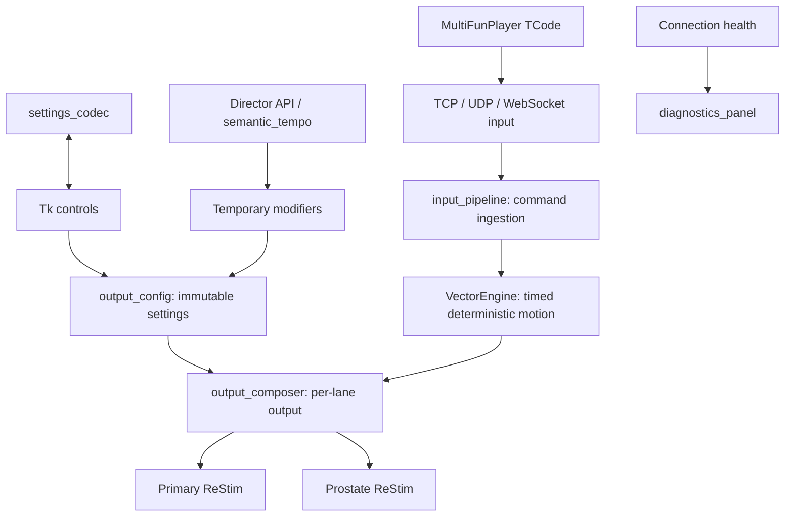

# Vector v87 architecture

app.py coordinates the application. navigation.py, response_panel.py, spatial_visibility.py and diagnostics_panel.py group presentation responsibilities. endpoints.py centralizes endpoint validation. Worker output composition reads settings snapshots rather than Tk variables.

Parameter response curves transform response values; Custom spatial curves define a spatial path. Their existing saved representations are retained.

Regression fixtures capture command output, settings and tempo behavior. Loopback tests cover reconnection and lane independence; UI tests block external activity. Hardware and Bluetooth pairing need separate validation.

## Windows source packaging

In an isolated Python 3.13 x64 environment, download wheels with `python -m pip download --no-deps --only-binary=:all: --require-hashes -r packaging/windows-py313-requirements.txt --dest wheels`. Build with `python packaging/build_custom_source.py --wheel-dir wheels --output dist`, then run `python packaging/check_archives.py`. The builder includes tracked source only and verifies each dependency hash. Dependency license metadata is retained in the ZIP.
